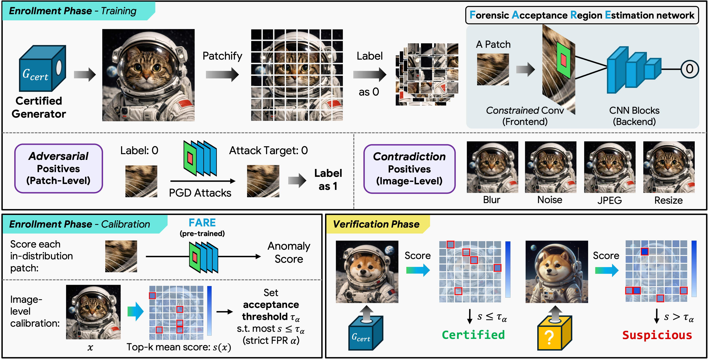

<h1 align="center">[NeurIPS '26] FARE</h1>
<h3 align="center">Forensic Acceptance Region Estimation<br>for Catching Bait-and-Switch Image Generators</h3>
<p align="center">Kai Yao &nbsp; · &nbsp; Marc Juarez<br>School of Informatics, The University of Edinburgh</p>
<p align="center"><a href="https://arxiv.org/abs/2609.30982"><strong>Paper</strong></a> &nbsp; | &nbsp; <a href="#method-overview">Method</a> &nbsp; | &nbsp; <a href="#main-results">Results</a> &nbsp; | &nbsp; <a href="#installation">Get started</a> &nbsp; | &nbsp; <a href="#citation">Citation</a></p>

---

A provider can certify one image generator and quietly serve another. FARE checks for this bait-and-switch using generated images alone. It learns forensic traces from the certified generator, then tests whether a query image is consistent with that generator.

We provide the PyTorch implementation, training and calibration code, image and batch scoring, PGD attack utilities, and component ablation configurations. The [example](examples/train_and_score.py) walks through training a verifier and scoring images from your own folders.

## Method overview

<p align="center"></p>

**Figure 1. FARE overview.** FARE learns from certified image patches, using near-boundary adversarial patches and contract-violating transformations as positive examples. Independent certified images set the acceptance threshold. To check a query image, FARE scores its patches and compares the average of the top-k scores with this threshold.

## Main results

Across four swap scenarios, FARE achieves mean true positive rates (TPR) of **92.56% to 99.45% at a 1% false positive rate (FPR)**. Training and calibration use outputs from a single certified generator.

**Table 1. Single-image swap detection.** TPR at 1% FPR (%), reported as mean ± standard deviation across certified/swapped generator pairs in each scenario.

| Method | CF-FFHQ | CF-Diff | WF-GANTrain | WF-SDVer |
|:--|--:|--:|--:|--:|
| Deep SVDD | 12.46 ± 29.05 | 0.00 ± 0.00 | 1.23 ± 0.62 | 1.21 ± 1.06 |
| OC-SVM | 6.89 ± 15.51 | 0.00 ± 0.00 | 0.76 ± 0.49 | 2.79 ± 4.31 |
| CLIP + OC-SVM | 13.91 ± 31.48 | 0.00 ± 0.00 | 1.34 ± 0.52 | 1.73 ± 1.66 |
| DCT Fingerprint + OC-SVM | 11.46 ± 26.84 | 0.00 ± 0.00 | 0.89 ± 0.40 | 3.07 ± 4.40 |
| FSD | 8.45 ± 13.60 | 18.40 ± 3.23 | 1.02 ± 0.23 | 11.23 ± 3.57 |
| NPR + OC-SVM | 10.92 ± 15.15 | 4.60 ± 1.12 | 0.77 ± 0.31 | 18.32 ± 5.19 |
| FARE w/o Constraint | 80.57 ± 27.93 | 7.95 ± 1.85 | 31.26 ± 21.14 | 8.24 ± 4.91 |
| FARE w/o Patch | 77.26 ± 30.38 | 10.38 ± 3.48 | 11.23 ± 10.51 | 7.36 ± 4.71 |
| FARE w/o Adv | 76.60 ± 33.05 | 28.77 ± 5.18 | 79.34 ± 24.26 | 35.33 ± 18.23 |
| FARE w/o Contradiction | 68.06 ± 34.01 | 65.78 ± 8.87 | 88.92 ± 10.25 | 72.08 ± 20.75 |
| FARE w/o Adv, Contradiction | 9.91 ± 22.28 | 0.97 ± 0.55 | 1.74 ± 1.01 | 1.56 ± 2.04 |
| **FARE (full)** | **99.43 ± 1.19** | **99.45 ± 0.88** | **96.38 ± 2.77** | **92.56 ± 3.06** |
| FARE (Full, under attack) | 99.28 ± 1.35 | 99.38 ± 0.91 | 95.73 ± 2.69 | 92.38 ± 3.42 |

CF-FFHQ and CF-Diff test swaps across generator families, using an FFHQ-256 generator pool and the diffusion-dominated CommunityForensics pool. WF-GANTrain and WF-SDVer test swaps between StyleGAN training configurations and Stable Diffusion versions. FARE outperforms the evaluated baselines in all four scenarios.

The "under attack" row uses white-box PGD against the trained verifier, with an L∞ perturbation budget of 0.025 and LPIPS < 0.05. Conditional attack success rate (ASR) measures the percentage of initially detected swapped images that the attack changes to accepted:

| Metric | CF-FFHQ | CF-Diff | WF-GANTrain | WF-SDVer |
|:--|--:|--:|--:|--:|
| Conditional PGD ASR (%) ↓ | 0.15 | 0.07 | 0.67 | 0.19 |

## Installation

Use Python 3.9 or newer and install [PyTorch and torchvision](https://pytorch.org/get-started/locally/) for your machine. Then run:

```bash
git clone https://github.com/kaikaiyao/FARE.git
cd FARE
python -m pip install -e ".[test]"
python -m pytest tests -q
```

For PGD with the paper's LPIPS constraint, install `python -m pip install -e ".[attack]"`.

## Public data resources

The experiments use publicly available resources:

- [FFHQ](https://github.com/NVlabs/ffhq-dataset): the face dataset underlying the FFHQ-trained generator pool.
- [DiffusionDB](https://poloclub.github.io/diffusiondb/): prompts for the Stable Diffusion experiments.
- [Community Forensics](https://huggingface.co/datasets/OwensLab/CommunityForensics) and its [evaluation set](https://huggingface.co/datasets/OwensLab/CommunityForensics-Eval): generated images for the cross-family diffusion evaluation.

The paper and appendix describe the generator pools, sampling, preprocessing, and evaluation settings.

## Train, calibrate, and score

Prepare three image folders:

- `certified_train/`: training images from the certified generator;
- `certified_calibration/`: independent images from the same generator for threshold calibration;
- `query_images/`: images to test.

From the repository root:

```bash
python examples/train_and_score.py \
  --train /path/to/certified_train \
  --calibration /path/to/certified_calibration \
  --query /path/to/query_images \
  --output outputs/fare \
  --device cuda
```

The example resizes RGB images to 256×256, trains FARE, and calibrates a threshold at the target 1% FPR. It saves the model, calibration metadata, and per-image scores and decisions in `outputs/fare/`. Scores above the threshold flag a possible generator swap.

The default [configuration](configs/methods/fare.yaml) uses 1,000,000 training steps and a 2,000-step warmup. For a quick CPU setup check, replace `--device cuda` with `--max-steps 2 --device cpu`.

Select an ablation with `--config`, using [fare_no_adv.yaml](configs/methods/fare_no_adv.yaml), [fare_no_bsconv.yaml](configs/methods/fare_no_bsconv.yaml), or [fare_no_contradiction.yaml](configs/methods/fare_no_contradiction.yaml).

## Python API

```python
from fare.training.fare import FAREScorer
from fare.training.calibration import quantile_threshold, calibrate_batch_thresholds
from fare.training.adversarial import pgd_forgery_attack
from fare.types import VerifierArtifact
```

`FAREScorer.fit` accepts a corpus manifest, as shown in the example. Restore a saved verifier with `FAREScorer.load(VerifierArtifact.load("outputs/fare/artifact.json"), device="cuda")`. For the paper's PGD evaluation, set `lpips_max=0.05`.

## Acknowledgments

FARE builds on the constrained convolution of [Bayar and Stamm (2016)](https://doi.org/10.1145/2909827.2930786) and PyTorch. Perceptual evaluation uses [LPIPS](https://github.com/richzhang/PerceptualSimilarity).

This work was supported by the Edinburgh International Data Facility (EIDF) and the Data-Driven Innovation Programme at the University of Edinburgh. Access to EIDF was facilitated through the University of Edinburgh's Generative AI Laboratory GAIL Fellow scheme.

## Citation

```bibtex
@inproceedings{yao2026fare,
  title = {{FARE}: Forensic Acceptance Region Estimation for Catching Bait-and-Switch Image Generators},
  author = {Yao, Kai and Juarez, Marc},
  booktitle = {Advances in Neural Information Processing Systems},
  year = {2026},
  note = {Accepted},
  url = {https://arxiv.org/abs/2609.30982}
}
```
